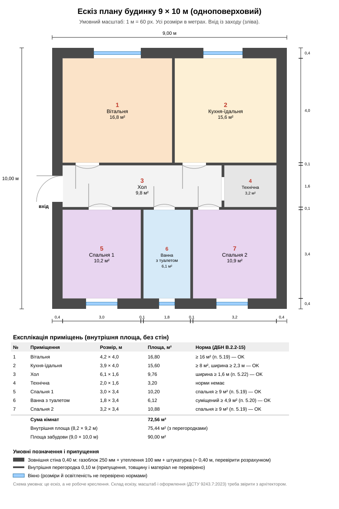

# Ескіз плану будинку 9 × 10 м

- **Дата:** 2026-10-26
- **Розділ:** building
- **Статус:** чернетка. Це ескіз, а не робоче креслення. Мінімальні площі й ширини перевірено за ДБН В.2.2-15:2019 з Зміною № 1, решта — припущення.

## Що змінилося порівняно зі схемою 8 × 10 м

У попередніх розрахунках суму кімнат 80 м² я прирівнював до габариту будинку 8 × 10 м, **не враховуючи товщину стін**. Зовнішня стіна ≈ 0,40 м (газоблок 250 мм + утеплення 100 мм + штукатурка, див. розрахунок утеплення в [`cost-estimate.md`](cost-estimate.md)), тому габарит 8 × 10 м дає внутрішній простір 7,2 × 9,2 м ≈ 66 м². Програма з окремою вітальнею ≥ 16 м² і двома спальнями ≥ 9 м² у цей простір не складається.

Габарит **9 × 10 м** (площа забудови 90 м²) дає внутрішній простір 8,2 × 9,2 м = 75,4 м² і вміщує всі приміщення з запасом.

**Альтернатива 8 × 10 м:** можливо, якщо об'єднати кухню з вітальнею в одну кімнату. ДБН В.2.2-15, п. 5.19, це допускає за умови електроплити й примусової витяжки. Така планування в цій нотатці не розроблялася.

## Приміщення (внутрішня площа, без стін)

| № | Приміщення | Розмір, м | Площа, м² | Норма | Статус |
|---|---|---|---|---|---|
| 1 | Вітальня | 4,2 × 4,0 | 16,80 | ≥ 16 м² (п. 5.19) | OK |
| 2 | Кухня-їдальня | 3,9 × 4,0 | 15,60 | ≥ 8 м², ширина ≥ 2,3 м (п. 5.19, 5.22) | OK |
| 3 | Хол | 6,1 × 1,6 | 9,76 | ширина ≥ 1,6 м (п. 5.22) | OK |
| 4 | Технічна | 2,0 × 1,6 | 3,20 | норми немає | — |
| 5 | Спальня 1 | 3,0 × 3,4 | 10,20 | ≥ 9 м² (п. 5.19) | OK |
| 6 | Ванна з туалетом | 1,8 × 3,4 | 6,12 | суміщений ≥ 4,9 м² (п. 5.20) | OK |
| 7 | Спальня 2 | 3,2 × 3,4 | 10,88 | ≥ 9 м² (п. 5.19) | OK |
| | **Сума кімнат** | | **72,56** | | |

Внутрішня площа 8,2 × 9,2 = 75,44 м² (різниця 2,88 м² — перегородки 0,10 м). Площа забудови 9,0 × 10,0 = 90,00 м².

**Запас:** вітальня 16,8 м² перевищує мінімум лише на 0,8 м², хол 1,6 м шириною дорівнює мінімуму передпокою. Зменшувати їх не можна.

## Розташування на ділянці 20 × 50 м

Будинок 9 × 10 м (3–12 по x, 3–13 по y) разом з гаражем і сараєм (одна будівля 9 × 6 м, 3–12 по x, 28–34 по y), вбиральнею й септиком проходить за відстанями ДБН Б.2.2-12:2019 (перевірено розрахунком):

| Відстань | Норма | Факт |
|---|---|---|
| Будинок — гараж/сарай | ≥ 15 м (табл. 6.7 для сараю) | 15,0 м |
| Будинок — вбиральня | ≥ 20 м (табл. 6.7) | 28,0 м |
| Будинок — септик | ≥ 5 м (табл. 6.7) | 8,2 м |
| Межі до будинку | ≥ 3 м (п. 6.1.41) | зліва 3, справа 8, від вулиці 3 |

Гараж із сараєм стоїть на 15,0 м від будинку, тобто **без запасу**. Це межа норми.

## Припущення і що не перевірено

- Внутрішні перегородки 0,10 м: товщину і матеріал не перевіряв (акустика, пожежні й конструктивні вимоги).
- Вікна: розміри взято з міркувань пропорції, норми природного освітлення не звіряв.
- Висоту приміщень не перевіряв.
- Двері: ширини 0,8–1,0 м, вхід із заходу (зліва). Норми на ширину дверей не звіряв.
- Технічна кімната призначена під котел, щит і введення комунікацій. Вимоги до розміщення газового обладнання (ДБН В.2.5-20) не перевіряв.
- Офіційну схему намірів забудови для будівельного паспорта треба узгодити з архітектором (див. [`house-sketch-howto.md`](house-sketch-howto.md)).

## Файли

- [`house-plan-sketch.svg`](house-plan-sketch.svg) — ескіз плану.
- [`yard-plan-10-sotok.svg`](yard-plan-10-sotok.svg) — схема ділянки (там будинок ще 8 × 10 м, треба оновити).
